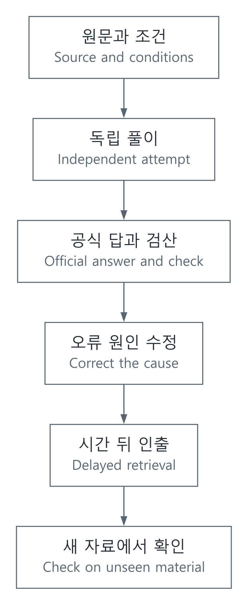

# 추론 연습과 통찰: 익숙함을 이해로 착각하지 않기

[추론과 적성시험](../README.md) · [인문·사회와 추론](../../추론과판단_REASONING_AND_JUDGMENT.md) · [English](#english)

## 무엇이 좋아졌는지 나누어 보기

해설을 읽을 때는 쉬워 보였는데 혼자 풀면 막히는 경우가 있습니다. 익숙하게 느끼는 것과 근거를 다시 만들어 내는 능력은 다릅니다. 또 같은 유형을 빨리 푸는 것과 처음 보는 영역의 추론까지 좋아지는 것도 다릅니다. 연습의 효과는 정확도, 시간, 설명의 완전성, 낯선 문제에의 적용을 나누어 확인합니다.

여기서 insight는 막연한 영감보다 “조건을 다르게 표현해 핵심 관계가 보이는 순간”에 가깝게 씁니다. 긴 문장을 표로 바꾸거나, 사례에서 공통 제약을 찾거나, 당연하게 보던 가정에 반례를 찾는 일이 포함됩니다. 이것은 이 기록에서 사용하는 작업상의 정의이며 IQ나 심리검사 점수를 대신하는 측정치는 아닙니다.

## 연구가 뒷받침하는 부분과 범위

| 방법 | 의미 | 근거를 읽을 때의 범위 |
| --- | --- | --- |
| 인출 연습 | 자료를 덮고 정의·해결 근거를 다시 꺼내 봅니다 | 학습 내용의 지연된 기억·이해 평가에 대한 근거를 일반 지능 향상으로 바꾸지 않습니다 |
| 분산 학습 | 한 번에 몰아서 끝내지 않고 시간 간격을 두고 다시 배웁니다 | 적절한 간격은 보존 기간과 자료·개인에 따라 달라집니다 |
| 피드백 | 답뿐 아니라 틀린 전제·누락 조건·계산을 확인합니다 | 불확실하거나 잘못된 해설을 반복하면 잘못된 규칙을 익힐 수 있습니다 |
| 새 문제에서 확인 | 답이 기억나는 자료와 처음 보는 자료를 나눕니다 | 익숙한 문항의 재풀이 성적을 전이 능력으로 해석하지 않습니다 |

[Purdue의 Karpicke·Blunt 연구](https://learninglab.psych.purdue.edu/downloads/2011/2011_Karpicke_Blunt_Science.pdf)는 과학 글 학습에서 인출 연습과 개념도 학습을 비교했습니다. [Kent State의 학습 전략 안내](https://www.kent.edu/kso/effective-learning-strategies)는 분산 학습·자기 설명·재학습을 연결합니다. 이 자료들은 특정 학습 방법의 근거이지 어떤 적성시험이든 같은 폭으로 점수가 오른다는 보장이 아닙니다.

Owen 등의 [2010년 연구](https://www.nature.com/articles/nature09042)에서는 6주간 온라인 인지 과제를 연습한 집단이 연습 과제에서는 나아졌지만, 연습하지 않은 과제로의 전이 근거는 확인되지 않았습니다. 이 한 연구로 모든 훈련이 무효라고 결론 내릴 수도 없지만, 특정 과제 성적 향상만 보고 일반 인지능력이 올랐다고 결론 내릴 수도 없습니다.

## 추론을 다시 만들 수 있는 연습

먼저 시간 제한 없이 풀이의 연결을 복원합니다. 어디서 어떤 조건을 썼는지 표시하고, 정답에 도달한 이유를 짧게 적습니다. 다음에는 공식 정답과 원문 조건으로 검산하고, 차이가 생긴 첫 지점을 찾습니다. 해설의 문장을 외우기보다 잘못 옮긴 관계를 고칩니다.

| 관찰한 실수 | 다시 확인할 대상 |
| --- | --- |
| 조건을 거꾸로 읽음 | 필요·충분조건과 부정 |
| 표의 큰 숫자를 그대로 비교함 | 분모·단위·기간·모집단 |
| 가능한 사례 하나를 필연으로 바꿈 | 모든 경우와 반례 |
| 주장에 어울리는 이유만 찾음 | 대안 설명과 반대 증거 |
| 아는 규칙을 새 상황에 과하게 적용함 | 원래 모델의 전제와 적용 범위 |

일정 시간이 지난 뒤 자료를 덮고 다시 설명합니다. 이후 같은 관계를 다른 주제나 표로 표현한 자료에서 확인합니다. 이것은 재현 가능한 학습 절차이지, 검증되지 않은 ‘통찰 점수’를 만드는 방식이 아닙니다. 연습 기록에는 공식 출처, 풀이 시간의 측정 범위, 정오, 오류의 종류와 수정 근거를 남깁니다.

## 측정도 모델입니다

$`n`$개 문항 중 맞힌 수가 $`k`$면 관찰 정확도는 $`k/n`$입니다. 하지만 서로 다른 난이도의 두 세트에서 정답률만 비교하면 학습 효과와 세트 차이가 섞입니다. 답을 이미 아는 문항, 시간 제한 변화, 중간 방해, 도구 사용도 조건을 바꿉니다.

시간은 푼 문항의 중앙값과 함께 분포를 보고, 미완료 문항 수를 따로 남깁니다. 오답을 버리고 정답 문항의 시간만 비교하면 결과가 편향될 수 있습니다. 새 자료·일정 기간 뒤의 자료를 별도로 두고 정확도와 속도를 함께 관찰합니다. 한 사람의 전후 기록만으로 인과적 효과나 일반 능력 향상을 확정하지 않습니다. [확률·추정](../../../분야_topics/06-수식과코드_math-to-code/해설_notes/확률평균추정의불확실성_probability-estimation.md)과 [사회 자료의 인과 해석](../../../인문사회_humanities/60-사회제도증거_society-institutions/해설_notes/사회를자료로읽기_evidence-causality-institutions.md)에서 측정 조건을 더 다룹니다.

[SVG](../../../자료_assets/도식_diagrams/practice-feedback-and-insight.svg) · [그림 원본 / Diagram source](../../../자료_assets/도식_diagrams/practice-feedback-and-insight.mmd)

이 문서를 위해 구성한 학습 기록 흐름입니다. 실제 기출의 공개 경로와 식별 방법은 [공식 시험 자료 안내](LEETPSAT기업검사_official-exams-and-past-papers.md)에 정리합니다.

## English

### Separate familiarity, performance and transfer

A solution can feel obvious while reading yet remain hard to reproduce independently. Familiarity is different from reconstructing a reason. Becoming faster on a familiar task also differs from improving reasoning in an unfamiliar domain. Observe accuracy, time, explanatory completeness and transfer separately.

Here insight has a working meaning: changing a representation so that an important relationship becomes visible. Examples include turning prose into a table, extracting shared constraints, or finding a counterexample to an unnoticed assumption. It is not an IQ measure or a substitute for a psychological assessment.

### Evidence and limits

Retrieval practice means reconstructing definitions or reasoning with the source closed. Distributed practice revisits learning across time. Feedback checks wrong premises, omitted conditions and calculations, not just the answer. New material distinguishes remembered answers from transfer.

The [Purdue Karpicke–Blunt study](https://learninglab.psych.purdue.edu/downloads/2011/2011_Karpicke_Blunt_Science.pdf) compared retrieval and concept-map study for science texts. [Kent State's teaching material](https://www.kent.edu/kso/effective-learning-strategies) connects distributed study, self-explanation and relearning. Evidence for retention or learning is not a guarantee of equal score gains on every aptitude test. Useful spacing depends on the retention interval, material and learner; unreliable feedback can reinforce a wrong rule.

In the [Owen et al. 2010 study](https://www.nature.com/articles/nature09042), six weeks of online cognitive practice improved trained tasks without evidence of transfer to untrained tasks. One study cannot establish that all training is ineffective, but improved practiced-task performance alone does not establish higher general cognitive ability.

### A reconstructable practice process

First rebuild an untimed chain of reasoning, marking which condition supports each step. Then compare the original conditions and official answer, locating the first divergence. Correct the relationship rather than memorizing the wording of a solution.

| Observed error | Recheck |
| --- | --- |
| Reversed implication | Necessary/sufficient conditions and negation |
| Compared large table values directly | Denominator, unit, period and population |
| Treated one possible case as necessary | Universal claims and counterexamples |
| Searched only for supportive reasons | Alternatives and contrary evidence |
| Overextended a familiar rule | The original model's assumptions and scope |

After a delay, reconstruct the explanation with the source closed; then test the same relationship in different material. This is an inspectable study process, not an invented insight score. Record source identity, timing scope, correctness, error type and correction evidence.

### Measurement conditions matter

Observed accuracy is $`k/n`$ for $`k`$ correct responses among $`n`$ items. Different item difficulty can confound comparisons between two sets. Previously seen answers, timing changes, interruptions and tools also alter conditions.

Report timing distributions, medians and unfinished items. Discarding wrong responses and comparing only correct-response times can bias the result. Use unseen and delayed material, and examine speed alongside accuracy. A single person's before/after record does not establish causal improvement or a change in general ability. See [probability and estimation](../../../분야_topics/06-수식과코드_math-to-code/해설_notes/확률평균추정의불확실성_probability-estimation.md#english) and [causal interpretation](../../../인문사회_humanities/60-사회제도증거_society-institutions/해설_notes/사회를자료로읽기_evidence-causality-institutions.md#english).

The original flow diagram above connects source conditions, independent attempt, official checking, error correction, delayed retrieval and unseen material. [Official exam sources](LEETPSAT기업검사_official-exams-and-past-papers.md#english) describe how past papers are identified.

## 출처 / Sources

- [Karpicke & Blunt, Science, 2011, author-hosted Purdue PDF](https://learninglab.psych.purdue.edu/downloads/2011/2011_Karpicke_Blunt_Science.pdf) — 인출 연습과 개념도 비교의 설계·범위 / study design and scope of retrieval versus concept mapping.
- [Kent State: Effective Learning Strategies](https://www.kent.edu/kso/effective-learning-strategies) — 분산 학습·자기 설명·재학습 / distributed practice, self-explanation and relearning.
- [Owen et al., Nature 465, 775–778, 2010](https://www.nature.com/articles/nature09042) — 훈련 과제 향상과 전이의 구분 / practiced-task gains versus transfer.

학습 내용의 기억·이해와 일반 인지능력의 전이를 구분해 근거를 대조했습니다. / Evidence was compared while separating learning/retention from transfer to general cognitive ability.
