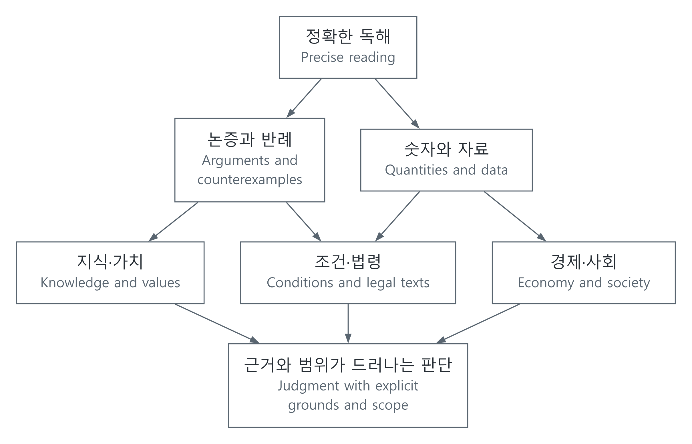

# 추론과 인문·사회: 근거를 읽고 판단하기

[전체 분야](../분야별목차_CATALOG.md) · [공학 기초](../공학기초_foundations/README.md) · [문서별 출처](../참고자료_references/추론출처_REASONING_SOURCES.md) · [English](#english)

조건을 정확히 읽고, 수치를 같은 기준으로 비교하고, 근거가 결론을 얼마나 뒷받침하는지 확인하는 과정을 다룹니다. 시험의 정답을 찾는 일과 현실의 복잡한 문제를 판단하는 일에는 공통 기술이 있지만, 필요한 지식과 확인 기준은 서로 다릅니다. 철학·경제·사회·법을 함께 읽으며 그 차이도 살핍니다.

## 추론·독해·적성시험

| 글 | 다루는 내용 |
| --- | --- |
| [형식 논리와 추론](57-추론적성시험_reasoning-assessments/해설_notes/명제와추론_formal-logic-and-inference.md) | 조건·양화·역과 대우·타당성, 진리표와 반례 |
| [논증 독해](57-추론적성시험_reasoning-assessments/해설_notes/논증독해_argument-reading-and-counterexamples.md) | 근거·결론·연결 가정, 필연과 약화의 차이 |
| [자료해석과 확률 추론](57-추론적성시험_reasoning-assessments/해설_notes/자료를숫자로읽기_quantitative-data-reasoning.md) | 분모·단위·비율·가중평균·기저율과 Bayes |
| [조건과 판단](57-추론적성시험_reasoning-assessments/해설_notes/조건을표로바꾸고반례로확인하기_constraint-and-decision-reasoning.md) | 제약 전파·경우 나누기·완전성·최소 비용 |
| [연습·피드백·통찰](57-추론적성시험_reasoning-assessments/해설_notes/추론연습과통찰_practice-feedback-and-insight.md) | 인출·분산 학습, 오류 수정, 새 자료로의 적용과 연구의 한계 |
| [공식 시험·기출 자료](57-추론적성시험_reasoning-assessments/해설_notes/LEETPSAT기업검사_official-exams-and-past-papers.md) | LEET·5급 PSAT·SKCT·GSAT·HMAT의 자료 구분과 공식 경로 |
| [실제 기출 분석](57-추론적성시험_reasoning-assessments/해설_notes/공식기출분석_official-past-paper-walkthroughs.md) | AKLS 공식 자료에서 확인한 2025학년도 LEET 추리논증 6번·28번 |

LEET와 PSAT는 문항의 학년도·시행연도·영역·책형·최종 정답 출처를 구분해 읽습니다. 기업 검사는 각 관계사·직무·시기의 공고가 기준이며, 인성검사와 적성검사도 같은 것으로 다루지 않습니다. 실제 기출 분석은 원문과 정답을 확인한 문항에만 붙입니다. 정의를 이해하기 위한 작은 수치·논리 예시는 기출 문항으로 표시하지 않습니다.

원문은 공식 공개 페이지로 연결하고, 이 저장소에는 자체 분석을 둡니다. 기업 공식 소개, 역사적인 공식 예시, 사설 복원 문제는 서로 다른 자료입니다. 출처를 적었다는 이유만으로 원문 전체의 재배포가 허용되는 것은 아닙니다.

## 철학·경제·사회·법

| 글 | 다루는 내용 |
| --- | --- |
| [지식·논증·가치](../인문사회_humanities/58-철학비판적사고_philosophy-critical-thinking/해설_notes/안다는것논증한다는것옳다고판단한다는것_knowledge-arguments-values.md) | 지식과 정당화, 사실 판단과 가치 판단, 반론과 수정 |
| [희소성·기회비용·유인](../인문사회_humanities/59-경제선택지표_economics/해설_notes/희소성에서선택으로_scarcity-opportunity-cost-incentives.md) | 선택의 대가, 한계 비교, 행동을 바꾸는 조건 |
| [GDP·물가·실질가치](../인문사회_humanities/59-경제선택지표_economics/해설_notes/GDP와물가읽기_gdp-inflation-real-values.md) | 지표 정의, 명목·실질, 기준시점과 해석 범위 |
| [증거·인과·제도](../인문사회_humanities/60-사회제도증거_society-institutions/해설_notes/사회를자료로읽기_evidence-causality-institutions.md) | 표본·비교집단·교란, 관측과 인과 추론, 제도 |
| [법의 출처·효력·해석](../인문사회_humanities/61-법령읽기_law-foundations/해설_notes/법령을읽는첫걸음_legal-sources-and-interpretation.md) | 대한민국 법령 체계, 시행시점, 요건·효과, 판례와 해석 |

철학적 입장은 논거와 반론을 통해 검토하고, 경험적 주장은 관측 방법과 자료로 확인합니다. 경제 지표는 단위·분모·기준시점이 맞아야 비교할 수 있습니다. 법령은 관할과 시점, 조문에서 정한 요건을 원문으로 확인합니다. 이 서로 다른 질문을 같은 하나의 점수로 판단하지 않습니다.

## 연결해서 읽기

[SVG](../자료_assets/도식_diagrams/reasoning_and_humanities.svg) · [그림 원본 / Diagram source](../자료_assets/도식_diagrams/reasoning_and_humanities.mmd)

직접 구성한 연결도입니다. 예를 들어 정책 자료를 읽을 때는 지표의 변화를 계산하는 것, 정책이 그 변화를 일으켰는지 판단하는 것, 그 정책을 바람직하다고 평가하는 것을 분리합니다. 법적 허용 여부도 별도로 확인합니다. 같은 숫자 하나로 이 질문들이 모두 해결되지는 않습니다.

[추론 계산 예제](../예제_examples/추론_reasoning/README.md)는 작은 명제논리·유리수 계산·유한 제약 모델을 독립적인 기준과 비교합니다. 자연어 의미 전체를 자동 판정하거나 시험 점수를 예측하는 프로그램은 아닙니다. 학습 방법의 근거도 학습 내용의 유지, 연습한 과제의 성능, 새 과제로의 전이를 나누어 기록했습니다.

## English

These notes examine precise reading, comparable quantities and the strength of reasons supporting a conclusion. Exam solving and real-world judgment share techniques but differ in required knowledge and verification criteria. Philosophy, economics, society and law help make those differences explicit.

### Reasoning, reading and assessments

| Article | Coverage |
| --- | --- |
| [Formal logic and inference](57-추론적성시험_reasoning-assessments/해설_notes/명제와추론_formal-logic-and-inference.md#english) | Conditions, quantifiers, contraposition, validity, truth tables and countermodels |
| [Argument reading](57-추론적성시험_reasoning-assessments/해설_notes/논증독해_argument-reading-and-counterexamples.md#english) | Evidence, conclusions, inferential assumptions, necessity versus weakening |
| [Quantitative data reasoning](57-추론적성시험_reasoning-assessments/해설_notes/자료를숫자로읽기_quantitative-data-reasoning.md#english) | Denominators, units, ratios, weighted means, base rates and Bayes |
| [Constraints and decisions](57-추론적성시험_reasoning-assessments/해설_notes/조건을표로바꾸고반례로확인하기_constraint-and-decision-reasoning.md#english) | Propagation, case splitting, completeness and minimum costs |
| [Practice, feedback and insight](57-추론적성시험_reasoning-assessments/해설_notes/추론연습과통찰_practice-feedback-and-insight.md#english) | Retrieval, spacing, correction, transfer and limits of evidence |
| [Official exams and past papers](57-추론적성시험_reasoning-assessments/해설_notes/LEETPSAT기업검사_official-exams-and-past-papers.md#english) | Official source distinctions for LEET, Grade 5 PSAT, SKCT, GSAT and HMAT |
| [Verified past-paper analysis](57-추론적성시험_reasoning-assessments/해설_notes/공식기출분석_official-past-paper-walkthroughs.md#english) | 2025-academic-year LEET reasoning items 6 and 28 verified in AKLS material |

Keep academic-year labels, administration years, sections, booklet forms and final-answer sources distinct. Corporate requirements depend on the affiliate, role and recruitment round. Personality inventories and aptitude tests are not interchangeable. Only questions with checked originals and answers are labeled past-paper analysis; small conceptual calculations are not labeled exam questions.

Original material is linked at its official source, with independent analysis here. Corporate process descriptions, historical official samples and commercial reconstructions are different sources. Attribution alone does not authorize full republication.

### Philosophy, economics, society and law

| Article | Coverage |
| --- | --- |
| [Knowledge, arguments and values](../인문사회_humanities/58-철학비판적사고_philosophy-critical-thinking/해설_notes/안다는것논증한다는것옳다고판단한다는것_knowledge-arguments-values.md#english) | Knowledge, justification, factual/value judgments, objections and revision |
| [Scarcity, opportunity cost and incentives](../인문사회_humanities/59-경제선택지표_economics/해설_notes/희소성에서선택으로_scarcity-opportunity-cost-incentives.md#english) | Choice costs, marginal comparisons and behavioral conditions |
| [GDP, inflation and real values](../인문사회_humanities/59-경제선택지표_economics/해설_notes/GDP와물가읽기_gdp-inflation-real-values.md#english) | Indicator definitions, nominal/real values, reference periods and scope |
| [Evidence, causality and institutions](../인문사회_humanities/60-사회제도증거_society-institutions/해설_notes/사회를자료로읽기_evidence-causality-institutions.md#english) | Samples, comparison groups, confounding, observations and causal inference |
| [Legal sources and interpretation](../인문사회_humanities/61-법령읽기_law-foundations/해설_notes/법령을읽는첫걸음_legal-sources-and-interpretation.md#english) | Korean legal sources, effective dates, conditions/effects and case interpretation |

Philosophical positions require reasons and objections; empirical claims require observational methods and evidence. Economic comparisons need consistent units, denominators and reference periods. Legal interpretation requires jurisdiction, dates and textual conditions. These different questions should not be reduced to a single score.

### Connecting the subjects

The original diagram above connects precise reading, arguments, data and domain knowledge. In policy analysis, calculating an indicator change, deciding whether a policy caused it, and evaluating whether the policy is desirable are separate tasks. Legal permissibility is another question. One number does not settle all of them.

[The reasoning examples](../예제_examples/추론_reasoning/README.md#english) compare small formal-logic, rational-arithmetic and finite-constraint models with independent references. They do not automatically resolve natural-language meaning or predict test scores. Learning-method evidence is also separated into retention, performance on practiced tasks, and transfer to new tasks.
