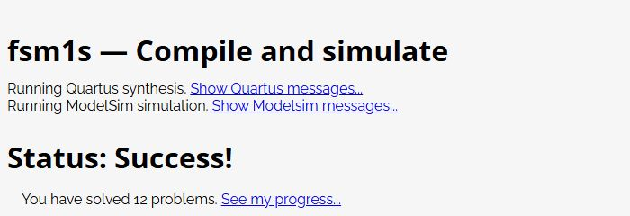

# HDLBits 사이트 채점 기록 — 2026-10-26

[풀이 목차](README.md) · [로컬 실행 기록](../확인기록_validation.md)

각 문제의 편집기에 저장소의 solution.v를 입력하고 Submit (new window)로 제출한 뒤 결과 화면의 Status: Success!를 직접 확인했습니다. 이 실행에서는 계정을 새로 만들거나 로그인하지 않았으며, 사이트가 제공하는 현재 브라우저의 진행 기록을 사용했습니다.

| 문제 | 실제 판정 | 제출 동작 횟수 | 최종 제출 소스 SHA-256 앞부분 | 채점 화면 |
| --- | --- | --- | --- | --- |
| [step_one](step_one/README.md) | Success! | 2 | `99cacd51a1ec106e…` | [화면](채점기록_evidence/step_one.jpg) |
| [vector2](vector2/README.md) | Success! | 2 | `8039a36063bb244b…` | [화면](채점기록_evidence/vector2.jpg) |
| [vectorr](vectorr/README.md) | Success! | 1 | `c31a2ad1152d9b28…` | [화면](채점기록_evidence/vectorr.jpg) |
| [popcount3](popcount3/README.md) | Success! | 1 | `910a57282d4ae200…` | [화면](채점기록_evidence/popcount3.jpg) |
| [mux2to1v](mux2to1v/README.md) | Success! | 1 | `6216134f84fdb6b5…` | [화면](채점기록_evidence/mux2to1v.jpg) |
| [fadd](fadd/README.md) | Success! | 1 | `5defb763da86d201…` | [화면](채점기록_evidence/fadd.jpg) |
| [always_case2](always_case2/README.md) | Success! | 1 | `5e8451bdd6360fd9…` | [화면](채점기록_evidence/always_case2.jpg) |
| [dff8r](dff8r/README.md) | Success! | 1 | `b91acdc7ae007082…` | [화면](채점기록_evidence/dff8r.jpg) |
| [count10](count10/README.md) | Success! | 1 | `8a0e4ffcd054bee8…` | [화면](채점기록_evidence/count10.jpg) |
| [shift4](shift4/README.md) | Success! | 1 | `c83fe086a8e753f7…` | [화면](채점기록_evidence/shift4.jpg) |
| [edgedetect](edgedetect/README.md) | Success! | 1 | `a0cbe9a98d8b36ab…` | [화면](채점기록_evidence/edgedetect.jpg) |
| [fsm1s](fsm1s/README.md) | Success! | 1 | `b314b91aa2bdd545…` | [화면](채점기록_evidence/fsm1s.jpg) |

최종 제출한 소스의 전체 SHA-256과 확인 시각은 [온라인 결과 JSON](채점기록_evidence/online-results.json)에 있습니다. 각 해시는 해당 폴더의 solution.v 바이트와 일치하는지 대조했습니다. 결과 주소 runsim.php는 POST로 열린 페이지이므로 주소 자체를 영구적인 개별 제출 조회 링크로 제시하지 않습니다.

step_one은 첫 iframe 제출의 결과 표시가 비어 있어 새 창으로 다시 제출했습니다. vector2는 첫 입력이 편집기에 반영되지 않아 빈 템플릿이 제출되어 Incorrect가 나왔으며, 입력된 코드를 확인한 뒤 같은 풀이를 다시 제출해 Success!를 확인했습니다. 나머지 문제는 한 번의 제출 동작으로 성공을 확인했습니다. 횟수는 브라우저에서 실행한 제출 동작 기준입니다.

사이트는 제출 회로의 합성과 참조회로와의 기능 시뮬레이션을 수행했습니다. 이 기록은 로컬 Icarus 검사와 별도이며, 특정 보드의 핀·전기 조건이나 배치·배선·타이밍 충족을 확인한 기록은 아닙니다.

