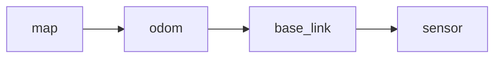

# 민간 실내 이동로봇의 센서·차체·지도 좌표 변환

[응용 시스템 목차](../README.md) · [전체 하드웨어 코딩](../../README.md) · [실제 명령·결과·해시](example.json)

민간 실내 운반 로봇을 가정하여 센서에서 본 점을 차체 좌표와 지도 좌표로 바꾸는 정적 계산입니다. C++17 표준 라이브러리만 사용하며 좌표 변환 함수와 독립 기하 검사를 일반 CPU에서 실행합니다. ROS 2·tf2를 구동하거나 로봇을 주행시킨 결과는 아닙니다.

## 좌표계와 단위 계약

길이는 미터, 회전은 라디안입니다. 몸체 축은 x가 앞, y가 왼쪽, z가 위이며 z축 주위의 양의 yaw는 반시계방향입니다. [REP 103의 단위·축·회전 관례](https://github.com/ros-infrastructure/rep/blob/master/rep-0103.rst)를 기준으로 합니다. 이 센서는 같은 몸체 축 관례를 사용하는 가상 센서이며 z-forward인 camera_optical 좌표를 그대로 대입하는 예가 아닙니다.

계산은 바닥의2차원 SE(2) 강체 변환으로 제한합니다. 높이·roll·pitch·축척 변화·반사는 없습니다. 이 예제의 지도 원점과 x·y 방향은 실내 건물에 고정했다고 가정합니다. 지도 좌표를 나침반의 북쪽 기준·시계방향 각도와 혼용하지 않습니다.

표기 T_A_B는 B좌표로 표현한 점을 A좌표로 옮깁니다. p_A=R_AB p_B+t_AB이며 t_AB는 B의 원점을 A에서 본 위치입니다. 따라서 T_map_base와 T_base_sensor를 합성하면 T_map_sensor입니다. 오른쪽의 센서 변환부터 적용합니다. 변환값 자체에 frame_id와 시각을 저장하지 않으므로 두 값의 중간 프레임이 같고 같은 시점에 해당하는지는 호출자가 확인하는 계약입니다.

## ROS 2의 프레임과 이 스냅샷

[REP 105](https://github.com/ros-infrastructure/rep/blob/master/rep-0105.rst)에서 base_link는 로봇에 고정된 프레임이며 일반적인 기본 관계는 map→odom→base_link입니다. map은 장기 기준이지만 위치 추정의 보정으로 불연속일 수 있고 odom은 연속적이지만 드리프트할 수 있습니다. 실내에서는 건물 구조에 맞춰 map을 정할 수 있습니다.



위 화살표는 TF 트리의 부모·자식 관계입니다. 점을 센서에서 지도로 옮기는 수식의 적용 방향과 화살표를 무조건 같다고 읽지 않습니다. 코드의 T_map_base는 한 시점의 map→odom→base_link 관계를 미리 합성한 값으로 가정합니다. 실제 TF 트리에 map과 odom을 동시에 base_link의 부모로 붙이는 예가 아닙니다.

[ROS 2의 tf2 공식 설명](https://github.com/ros2/ros2_documentation/blob/rolling/source/ROS-Framework/interfaces/About-Tf2/About-Tf2.rst)은 프레임 관계를 시간에 따라 버퍼링하고 필요한 방향으로 변환하는 역할을 설명합니다. 이 코드는 그 시간 조회·메시지·보간을 구현하지 않습니다. 실제 시스템에서는 source·target 프레임, 타임스탬프, 센서 장착 보정과 lookup 방향을 함께 확인해야 합니다. 프레임의 자세를 표현하는 것과 점의 좌표를 변환하는 것의 역관계도 공식 문서에서 구분합니다.

## 직접 구성한 입력의 흐름

센서 원점은 차체 앞0.20m이고 센서 축은 차체 기준90도 회전했다고 정합니다. 차체는 지도에서(2,3)m에 있고 지도 기준90도 회전합니다. 센서 좌표의(1,0)m를 변환합니다.

| 단계 | 계산 | 좌표 |
| --- | --- | --- |
| 도→라디안 |90×pi/180 | pi/2 rad |
| 센서 점 회전 |(1,0)을90도 회전 |(0,1)m |
| 장착 위치 추가 |(0.20,0)m 추가 | 차체에서(0.20,1.00)m |
| 차체 자세 회전 |(0.20,1.00)을90도 회전 |(−1.00,0.20)m |
| 지도 위치 추가 |(2,3)m 추가 | 지도에서(1.00,3.20)m |

두90도 회전만 더하고 평행이동을 단순히 더하면 장착 위치의 축이 섞입니다. 합성은 t_AC=R_AB t_BC+t_AB, yaw_AC=yaw_AB+yaw_BC로 계산합니다. inverse는 p_B=R_AB의 전치×(p_A−t_AB)이므로 이동도 역회전해야 합니다. 위치 부호만 바꾸는 것으로 끝나지 않습니다.

각도는 remainder로−pi~pi 범위의 대표값에 정리합니다. pi와−pi는 같은 방향이므로 방향 검사는 cos·sin으로 수행합니다. 180도와−180도가 숫자로 다르다는 이유만으로 다른 자세라고 판단하지 않습니다.

## 독립 검사와 수치 오차

직접90도·−90도·순수 이동의 수작업 기준을 먼저 확인합니다. 이어 각도7종과 위치3종의21개 변환, 점5개를 사용합니다. 역변환 왕복, 두 점의 거리 보존, 별도3×3 동차행렬과 일반 행렬 곱의 결과를 대조합니다. 합성 함수의 이동식을 그대로 다른 이름으로 복사한 기준은 아닙니다.

스칼라 비교는 abs(a−b)≤1e−10+1e−10×max(abs(a),abs(b))입니다. 좌표·거리의 절대 항은 미터, 각도 비교라면 라디안, cos·sin 비교라면 무차원입니다. NaN·무한대는 통과시키지 않으며 변환 생성에서도 명시적으로 거절합니다. tolerance는 이 작은 수치 모델의 검산 기준이며 센서 정확도나 위치 추정의 신뢰구간이 아닙니다. 매우 큰 유한 좌표에서의 오차 범위를 이 실행으로 보장하지 않습니다.

한 점 변환·합성·역변환은 상수 시간과 상수 추가 저장을 사용합니다. 검증용 목록과 행렬은 계산 함수를 대조하기 위한 별도 저장입니다.

## 실제 실행 결과

2026-10-26에 Windows x64의 Zig C++ 프런트엔드 Clang21.1.0으로 C++17, -O2,-Wall,-Wextra,-Werror를 사용했습니다. 컴파일과 정상 실행의 종료 코드는0이며 컴파일 stderr는 비어 있습니다.

```text
TRACE base=(0.200000,1.000000) map=(1.000000,3.200000)
PASS robot-frames checks=9526 inverse_points=105 composition_pairs=441 composition_points=2205 max_error_m=2.512e-15
```

총9,526개 조건 비교, 왕복 점105개, 합성 쌍441개·합성 점2,205개를 확인했습니다. 기록한 최대 점 오차2.512e−15m는 이번 입력과 실행 환경에서 관측한 값입니다. 다른 수학 라이브러리에서 같은 마지막 비트의 오차가 나와야 한다고 요구하지 않습니다.

--negative-order는 첫 시연에서 두 변환 순서만 의도적으로 바꿉니다. 실제 결과(−3.8,2.0)m가 수작업 기준(1.0,3.2)m와 달라 종료1로 검출되었습니다. 잘못된 변환을 성공 결과로 집계하지 않습니다. 수치 함수 테스트가 실제 센서 장착값의 정확성을 확인한 것은 아닙니다.

## 실행 명령

다음 PowerShell은 저장소 루트에서 소스를 새 임시 폴더로 복사합니다. 다른 C++17 컴파일러를 사용한다면 실행 파일 경로와 출력 옵션을 해당 환경에 맞춥니다. 표준 입력은 없으며 기본 실행이 자체 기하 검사를 수행합니다.

```powershell
$source = Resolve-Path '하드웨어코딩_hardware-coding/응용시스템_applied-systems/01-이동로봇좌표_robot-frames'
$build = Join-Path ([IO.Path]::GetTempPath()) ('robot-frames-' + [Guid]::NewGuid().ToString('N'))
New-Item -ItemType Directory -Path $build | Out-Null
Copy-Item (Join-Path $source 'example.cpp') $build
Push-Location $build
& 'C:/Users/test2/Documents/ChatGPT/코딩/tmp/c-compiler/ziglang/zig.exe' c++ -std=c++17 -Wall -Wextra -Werror -O2 example.cpp -o example.exe
& .\example.exe
& .\example.exe --negative-order
Pop-Location
```

마지막 실행은 의도적으로 종료1을 반환합니다. 실제 명령·stdout·stderr·반환 코드와 소스 SHA-256은 example.json에 보존합니다.

## 사용처와 한계

실내 로봇의 센서 관측을 지도에 표시하거나 서로 다른 센서의 점을 같은 좌표계에서 비교하는 계산의 기초입니다. 이 예제는 센서 보정·오도메트리·위치 추정·SLAM을 해결하지 않으며 불확실성·시간 오차·3차원 경사를 모델링하지 않습니다. ROS 2 노드 통신·tf2 통합·경로 추종·실차 주행·충돌 안전성 시험도 포함하지 않습니다.

## 공식 근거

- [REP 103: 표준 단위·좌표 관례](https://github.com/ros-infrastructure/rep/blob/master/rep-0103.rst)
- [REP 105: 이동 플랫폼의 프레임 의미와 트리](https://github.com/ros-infrastructure/rep/blob/master/rep-0105.rst)
- [ROS 2 tf2 공식 문서 원문](https://github.com/ros2/ros2_documentation/blob/rolling/source/ROS-Framework/interfaces/About-Tf2/About-Tf2.rst)

문서 열람 기준일은2026-10-26입니다. 위의 수치·좌표 예·C++ 구현·검사 입력은 직접 구성했습니다.


## 전체 소스와 줄별 복습 메모

각 실제 코드 줄의 오른쪽 주석에 문법과 사용하는 좌표·조건의 목적을 함께 적었습니다. 외부 표준 입력은 없으며 직접 구성한 예제와 독립 검사를 실행합니다.

```cpp
#include <algorithm> // 오차 크기의 최댓값 계산
#include <array> // 독립3×3 동차행렬과 고정 입력
#include <cmath> // 라디안 삼각함수·거리·각도 나머지
#include <iomanip> // 미터 좌표와 작은 오차의 출력 자릿수
#include <iostream> // 실제 좌표와 검사 집계 출력
#include <limits> // 비유한 입력의 거절 검사
#include <stdexcept> // 잘못된 입력과 검사 실패 구분
#include <string> // 음성 대조 명령행 선택
#include <vector> // 교차 검사할 좌표 변환 목록
struct Point { double x_m, y_m; }; // 바닥 평면의 미터 좌표
struct Transform { double x_m, y_m, yaw_rad; }; // 자식 원점의 부모 좌표와 반시계 회전
using Matrix = std::array<std::array<double, 3>, 3>; // 별도 기준으로 사용할 동차행렬
constexpr double pi = 3.14159265358979323846; // 도와 라디안의 변환 상수
constexpr double abs_tol = 1e-10, rel_tol = 1e-10; // 절대 오차와 크기에 비례한 허용 오차
int checks = 0, inverse_points = 0, composition_pairs = 0, composition_points = 0; // 실제 비교와 입력 수
double max_error_m = 0; // 비교한 두 점의 최대 유클리드 오차
double radians(double degrees) { return degrees * pi / 180.0; } // 도 단위를 삼각함수에 맞는 라디안으로 변경
double wrap(double angle) { return std::remainder(angle, 2.0 * pi); } // 같은 회전을−pi~pi의 대표값으로 정리
Transform make_transform(double x, double y, double yaw) { // 입력 변환의 단위와 유한성 경계
    if (!std::isfinite(x) || !std::isfinite(y) || !std::isfinite(yaw)) throw std::invalid_argument("non-finite transform"); // NaN·무한대의 조용한 전파 방지
    return {x, y, wrap(yaw)}; // 평행이동과 정리한 회전 저장
} // 변환 생성 끝
Point apply(const Transform& t, const Point& p) { // T_A_B로B의 점을A 좌표로 옮기기
    const double c = std::cos(t.yaw_rad), s = std::sin(t.yaw_rad); // 회전의 두 기저 성분
    return {c * p.x_m - s * p.y_m + t.x_m, s * p.x_m + c * p.y_m + t.y_m}; // 먼저 회전한 뒤 부모 좌표의 이동 추가
} // 점의 좌표 변환 끝
Transform compose(const Transform& a_b, const Transform& b_c) { // T_A_B 뒤에T_B_C를 연결해T_A_C 구성
    const Point origin = apply(a_b, {b_c.x_m, b_c.y_m}); // C의 원점을A 좌표로 옮기기
    return {origin.x_m, origin.y_m, wrap(a_b.yaw_rad + b_c.yaw_rad)}; // 이동과 합성 회전 반환
} // 같은 중간 좌표계의 변환 합성 끝
Transform inverse(const Transform& t) { // T_A_B의 역인T_B_A 계산
    const double c = std::cos(t.yaw_rad), s = std::sin(t.yaw_rad); // 역회전에도 같은 삼각 성분 사용
    return {-c * t.x_m - s * t.y_m, s * t.x_m - c * t.y_m, wrap(-t.yaw_rad)}; // −R전치t와−yaw로 이동과 회전을 함께 뒤집기
} // 역변환 끝
Matrix matrix_of(const Transform& t) { // 점 변환 함수와 별도로 행렬 기준 만들기
    Matrix result{}; // 모든 행렬 원소를0으로 초기화
    const double c = std::cos(t.yaw_rad), s = std::sin(t.yaw_rad); // 회전 기저 성분
    result[0] = {c, -s, t.x_m}; // 첫 행의x 회전·이동 성분
    result[1] = {s, c, t.y_m}; // 둘째 행의y 회전·이동 성분
    result[2] = {0, 0, 1}; // 점의 동차 좌표를 유지할 마지막 행
    return result; // 독립 기준 행렬 반환
} // 행렬 구성 끝
Matrix multiply(const Matrix& left, const Matrix& right) { // 합성 함수를 복사하지 않는 일반 행렬 곱
    Matrix result{}; // 곱의 누적값 초기화
    for (int row = 0; row < 3; ++row) { // 결과 행 선택
        for (int col = 0; col < 3; ++col) { // 결과 열 선택
            for (int k = 0; k < 3; ++k) result[row][col] += left[row][k] * right[k][col]; // 세 공통 성분의 내적 누적
        } // 한 행의 모든 열 끝
    } // 3×3 행렬 곱 끝
    return result; // 실제 곱 결과 반환
} // 독립 행렬 곱 기준 끝
Point matrix_point(const Matrix& matrix, const Point& point) { // 동차행렬의 점 기준 계산
    return {matrix[0][0] * point.x_m + matrix[0][1] * point.y_m + matrix[0][2], matrix[1][0] * point.x_m + matrix[1][1] * point.y_m + matrix[1][2]}; // 입력의 세 번째 성분1을 포함한 두 내적
} // 행렬 기준의 점 계산 끝
bool close(double actual, double expected) { // 크기가 다른 수의 허용 오차 비교
    return std::isfinite(actual) && std::isfinite(expected) && std::abs(actual - expected) <= abs_tol + rel_tol * std::max(std::abs(actual), std::abs(expected)); // 비유한 결과는 통과시키지 않기
} // 스칼라 근접 판정 끝
void require(bool condition, const char* reason) { // 실제 비교 수와 실패 이유 기록
    ++checks; // 실행한 조건 검사 누적
    if (!condition) throw std::runtime_error(reason); // 첫 불일치에서 검사 실패
} // 공통 검사 끝
void check_point(Point actual, Point expected) { // 점의 두 좌표를 같은 미터 기준으로 비교
    require(close(actual.x_m, expected.x_m), "coordinate x"); // x 좌표의 절대·상대 오차 확인
    require(close(actual.y_m, expected.y_m), "coordinate y"); // y 좌표의 절대·상대 오차 확인
    max_error_m = std::max(max_error_m, std::hypot(actual.x_m - expected.x_m, actual.y_m - expected.y_m)); // 실제 점 오차 최댓값 기록
} // 점 비교 끝
int main(int argc, char** argv) { // 민간 실내로봇의 정적 좌표 예제 실행
    const bool negative = argc == 2 && std::string(argv[1]) == "--negative-order"; // 변환 순서 오류의 음성 대조 선택
    if (argc > 2 || (argc == 2 && !negative)) { std::cerr << "usage: example [--negative-order]\n"; return 2; } // 잘못된 실행 옵션 구분
    try { // 입력·계산·검사 실패를 종료 코드로 전달
        require(close(radians(180), pi), "degrees to radians180"); // 180도가pi 라디안인지 확인
        require(close(radians(90), pi / 2), "degrees to radians90"); // 90도를 그대로 삼각함수에 넣는 실수 방지
        const Transform T_base_sensor = make_transform(0.20, 0.00, radians(90)); // 센서 원점은 로봇 앞0.2m이고 축은90도 회전
        const Transform T_map_base = make_transform(2.0, 3.0, radians(90)); // 지도에서 로봇 원점과 자세를 고정한 스냅샷
        const Point sensor_point{1.0, 0.0}; // 센서 앞1m에서 관측한 가상 점
        const Point base_point = apply(T_base_sensor, sensor_point); // 센서 좌표를 로봇 좌표로 변환
        const Transform T_map_sensor = negative ? compose(T_base_sensor, T_map_base) : compose(T_map_base, T_base_sensor); // 음성 대조에서만 중간 프레임 순서를 잘못 연결
        const Point map_point = apply(T_map_sensor, sensor_point); // 합성 변환으로 지도 좌표 계산
        std::cout << std::fixed << std::setprecision(6) << "TRACE base=(" << base_point.x_m << ',' << base_point.y_m << ") map=(" << map_point.x_m << ',' << map_point.y_m << ")\n"; // 실제 계산 좌표를 미터로 출력
        check_point(base_point, {0.2, 1.0}); // 90도 회전의 직접 기하 기준
        check_point(map_point, {1.0, 3.2}); // 서로 다른 두90도 회전·이동의 수작업 기준
        check_point(apply(make_transform(0, 0, radians(-90)), {1, 0}), {0, -1}); // 시계방향 회전의 부호 확인
        check_point(apply(make_transform(2, 3, 0), {-1, 4}), {1, 7}); // 회전이 없는 순수 평행이동 확인
        const std::array<double, 7> angles{-180, -90, -30, 0, 30, 90, 180}; // 회전 방향과pi 경계를 포함한 입력
        const std::array<Point, 3> translations{{{0, 0}, {2, -3}, {-1.5, 0.25}}}; // 서로 다른 위치와 음수 이동
        const std::array<Point, 5> points{{{0, 0}, {1, 0}, {0, 1}, {-2, 3}, {5, -4}}}; // 원점·기저·일반 점
        std::vector<Transform> transforms; // 교차 검사할21개 변환
        for (double degrees : angles) for (Point origin : translations) transforms.push_back(make_transform(origin.x_m, origin.y_m, radians(degrees))); // 각도와 이동의 전조합 구성
        for (const Transform& t : transforms) { // 각 변환의 역·거리·행렬 성질 확인
            for (Point point : points) { // 다섯 입력 점의 왕복 변환
                check_point(apply(inverse(t), apply(t, point)), point); // T역T가 원래 점을 돌려주는지 비교
                check_point(apply(t, point), matrix_point(matrix_of(t), point)); // 별도 행렬 계산과 대조
                ++inverse_points; // 실제 왕복 점 수 누적
            } // 현재 변환의 점 검사 끝
            for (std::size_t i = 0; i < points.size(); ++i) for (std::size_t j = i + 1; j < points.size(); ++j) { // 두 점 사이의 모든 거리
                const Point a = apply(t, points[i]), b = apply(t, points[j]); // 같은 강체 변환을 두 점에 적용
                require(close(std::hypot(a.x_m - b.x_m, a.y_m - b.y_m), std::hypot(points[i].x_m - points[j].x_m, points[i].y_m - points[j].y_m)), "rigid distance"); // 강체 변환의 미터 거리 보존
            } // 거리 성질 확인 끝
            const Transform identity = compose(inverse(t), t); // 역과 원래 변환의 합성
            check_point({identity.x_m, identity.y_m}, {0, 0}); // 합성 이동이0인지 확인
            require(close(std::cos(identity.yaw_rad), 1) && close(std::sin(identity.yaw_rad), 0), "identity orientation"); // pi와−pi의 표현 차이 없이 방향 비교
        } // 단일 변환 성질 검사 끝
        for (const Transform& a : transforms) for (const Transform& b : transforms) { // 21×21 합성 순서 조합
            const Transform combined = compose(a, b); // 직접 구현한SE2 합성
            const Matrix reference = multiply(matrix_of(a), matrix_of(b)); // 일반3×3 곱의 독립 기준
            for (Point point : points) { // 각 합성에 다섯 점 적용
                check_point(apply(combined, point), matrix_point(reference, point)); // 행렬 합성 기준과 실제 점 비교
                check_point(apply(combined, point), apply(a, apply(b, point))); // 오른쪽 변환부터 적용하는 순서 확인
                ++composition_points; // 실제 합성 점 수 누적
            } // 합성 점 검사 끝
            ++composition_pairs; // 실제 변환 쌍 수 누적
        } // 전체 합성 교차 검사 끝
        const std::array<Transform, 3> invalid{{{std::numeric_limits<double>::infinity(), 0, 0}, {0, std::numeric_limits<double>::quiet_NaN(), 0}, {0, 0, std::numeric_limits<double>::infinity()}}}; // 비유한 이동·회전 입력
        for (const Transform& bad : invalid) { // 잘못된 수치가 조용히 들어가지 않는지 확인
            bool rejected = false; // 이번 입력의 거절 여부
            try { (void)make_transform(bad.x_m, bad.y_m, bad.yaw_rad); } catch (const std::invalid_argument&) { rejected = true; } // 명시적 입력 오류만 수집
            require(rejected, "reject non-finite transform"); // NaN·무한대를 정상값으로 취급하지 않기
        } // 입력 거절 검사 끝
        std::cout << "PASS robot-frames checks=" << checks << " inverse_points=" << inverse_points << " composition_pairs=" << composition_pairs << " composition_points=" << composition_points << " max_error_m=" << std::scientific << std::setprecision(3) << max_error_m << '\n'; // 실제 검사 수와 오차 출력
        return 0; // 모든 정적 기하 검사가 맞은 종료
    } catch (const std::exception& error) { // 잘못된 합성 순서나 수치 결과 처리
        std::cerr << "FAIL robot-frames " << error.what() << '\n'; // 불일치 종류를 원래 출력으로 기록
        return 1; // 검사 실패를 실행 종료 코드에 반영
    } // 예외 처리 끝
} // 정적 좌표 변환 예제 끝
```
