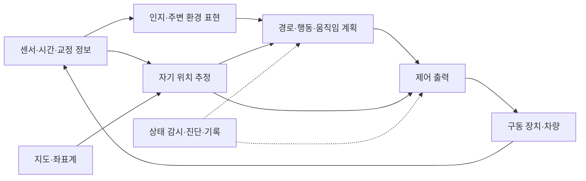

# 자율주행·로봇·우주 시스템의 구조와 검증 | Applied-system architecture and verification

응용 시스템은 센서 하나나 알고리즘 하나만으로 동작하지 않습니다. 입력이 언제·어느 좌표계에서 만들어졌는지, 계산이 무엇을 가정하는지, 출력이 어떤 장치에 전달되는지와 고장 때 어떤 상태를 남기는지가 함께 맞아야 합니다. 여기서는 민간 실내 로봇, 교육용 지구 위성 계산과 벤치 계측을 통해 분야 사이의 공통 구조를 읽습니다.

[공개 프로젝트와 언어](공개프로젝트와언어_sources-and-languages.md) · [기존 로봇 제어 목차](../../전자컴퓨터공학_ece/22-로봇제어_robotics-boards/README.md) · [산업별 항공우주 개요](../../산업별전자와컴퓨팅_industry-systems/03-방산전자와항공우주_defense-aerospace.md)

## 자율주행은 여러 정보 흐름을 연결합니다

자율주행 소프트웨어는 센서의 관측을 인지와 자기 위치 추정에 사용하고, 경로·행동·움직임을 계획한 뒤 제어 출력으로 연결합니다. 모든 기능이 한 번씩 차례로 끝나는 단일 함수라기보다, 서로 다른 주기와 지연을 가진 모듈이 메시지를 주고받는 구조입니다. [Autoware 공식 저장소](https://github.com/autowarefoundation/autoware)는 인지·자기 위치·계획·제어를 포괄하는 자율주행 소프트웨어를 연결하는 출발점입니다.

이 그림은 기능의 관계를 정리한 개념도이며 특정 제품의 전체 배선도나 완전한 Autoware 구현도는 아닙니다. 상태 감시와 기록은 한 단계 뒤에 붙이는 기능이 아니라 센서부터 출력까지 관측해야 하는 공통 흐름입니다.

| 기능 | 무엇을 입력으로 읽는지 | 무엇을 내놓는지 | 함께 확인할 조건 |
| --- | --- | --- | --- |
| 센서 취득 | 물리 신호·장치 상태·표본 시각입니다. | 시간·단위·교정 정보가 있는 표본입니다. | 누락·포화·시각 불일치·장치 재시작입니다. |
| 인지 | 센서 표본과 교정 정보입니다. | 주행 환경을 표현한 결과와 불확실성입니다. | 관측 한계와 잘못된 확신, 자료의 신선도입니다. |
| 자기 위치 추정 | 센서·이전 상태·지도·좌표 변환입니다. | 위치·자세·속도와 추정 불확실성입니다. | 좌표·단위·관측 시점·모델 가정입니다. |
| 계획 | 현재 상태·환경 표현·민간 이동 목적입니다. | 이동 가능한 경로와 시간에 따른 계획입니다. | 이동 가능 영역·해의 부재·변경된 입력입니다. |
| 제어 | 계획과 추정 상태입니다. | 구동 장치가 해석할 명령입니다. | 주기·지연·출력 제한·중단 조건입니다. |
| 상태 감시 | 모듈의 진행·오류·통신 상태입니다. | 유효성·오류 기록과 상태 전이입니다. | 마지막 값 유지와 정상 수신의 구분입니다. |

실내 격자 A*는 정한 격자와 이동 비용에서 경로를 찾는 작은 계산입니다. 센서 인지, 차량의 연속 운동과 제동, 지도 갱신까지 구현한 자율주행 스택이 아닙니다. 1차원 AGV 측정 융합도 정한 선형 모델과 잡음 가정의 추정 예제이며 실제 센서 시간 동기나 실차 위치 보장을 대신하지 않습니다. [Open AD Kit의 planning simulation](https://autowarefoundation.github.io/openadkit/deployments/planning-simulation/)처럼 외부 스택의 통합 실습은 별도 환경과 기록이 필요합니다.

## 로봇은 좌표·기구·관측 시간을 함께 맞춥니다

좌표 숫자만으로는 위치의 뜻이 정해지지 않습니다. 지도, 로봇 차체와 센서의 기준이 다르므로 점이 어느 좌표계에서 표현됐는지와 어떤 시각의 변환을 사용했는지 적어야 합니다. 길이와 각도의 단위, 축 방향과 회전의 양의 방향도 인터페이스의 일부입니다. [ROS REP 103 원문](https://github.com/ros-infrastructure/rep/blob/master/rep-0103.rst)은 단위·축 관례를, [REP 105 원문](https://github.com/ros-infrastructure/rep/blob/master/rep-0105.rst)은 이동 플랫폼의 좌표계 의미를 설명합니다. 교육 예제의 좌표 약속을 모든 로봇의 센서 좌표와 자동으로 같다고 가정하지 않습니다.

정기구학은 관절 값과 링크 구조에서 말단의 위치·자세를 계산합니다. 기구학 계산이 맞아도 관절 축·원점·단위가 잘못된 모델을 읽으면 다른 위치가 나옵니다. URDF 같은 구조 문서는 링크와 관절의 관계를 표현하지만 XML 형식이 정상이라는 사실만으로 관절 범위·기구 간섭·관성·접촉이 모두 타당해지지는 않습니다. Gazebo의 [로봇 만들기](https://gazebosim.org/docs/jetty/building_robot/)는 모델의 링크·관절과 물리 정보를 실제 시뮬레이터에 연결하는 다음 단계입니다.

기존 [차동구동 해설](../../전자컴퓨터공학_ece/22-로봇제어_robotics-boards/해설_notes/차동구동로봇_differential-drive-kinematics-odometry.md)은 미끄럼 없는 평면 운동에서 바퀴 회전과 위치 변화를 다룹니다. [속도 PI와 포화](../../전자컴퓨터공학_ece/22-로봇제어_robotics-boards/해설_notes/속도PI와포화_speed-pi-anti-windup.md)는 제어기 출력 제한과 상태를 설명합니다. 새 실내 좌표·2링크 모형은 이 관계를 작은 입력으로 추적하는 경로이며 모터·보드·로봇을 실제 구동한 기록과 구분합니다.

## 위성·발사체는 탑재 장치와 지상 체계를 나누어 봅니다

우주 시스템의 공통 소프트웨어를 공부할 때에는 센서 계측, 탑재 컴퓨팅, 전원 상태, 데이터 저장·통신, 지상에서의 관측과 검증을 먼저 나눕니다. 위성과 발사체는 임무·환경·운용 조건이 서로 다르므로 같은 코드와 시험 조건이 그대로 통용된다고 가정하지 않습니다. 여기서 다루는 계산은 교육용 지구 위성 원궤도와 벤치 메시지이며 발사체의 비행 경로·추진·운용을 재현하지 않습니다.

[NASA Small Spacecraft Technology](https://www.nasa.gov/smallsat-institute/sst-soa/)의 Power, Small Spacecraft Avionics, Communications, Ground Data Systems and Mission Operations 항목은 전원·탑재 처리·통신·지상 체계를 나누어 읽는 자료입니다. 그 소형 위성 자료의 특정 기술 성숙도나 구성을 모든 발사체에 적용하는 근거로 사용하지 않습니다.

| 영역 | 기능의 역할 | 학습할 인터페이스·기록 |
| --- | --- | --- |
| 탑재 컴퓨팅 | 여러 기능의 계산·작업·상태 관리를 수행합니다. | 작업의 실행 문맥, 메시지 큐, 데이터 소유권과 오류 전달입니다. |
| 계측·데이터 처리 | 장치의 관측을 형식·단위·시각과 함께 저장·전달합니다. | 표본 유효성, 누락·중복·순서·신선도와 자료 판본입니다. |
| 전원·열 상태 | 장치에 필요한 전원과 상태를 관측·관리합니다. | 전압·전류·온도·장치 상태의 단위와 측정 조건입니다. |
| 통신·지상 체계 | 탑재 정보와 지상의 관측·기록 체계를 연결합니다. | 메시지 형식·시간 기준·버전 호환과 수신 기록입니다. |
| 통합·환경 시험 | 개별 부품과 통합 상태가 정한 환경에서 기능하는지 확인합니다. | 시험 대상 판본, 구성, 계측기·조건·이상 기록입니다. |

cFS와 F Prime은 이 가운데 재사용 가능한 탑재 소프트웨어 구조를 읽는 공개 자료입니다. [cFS README](https://github.com/nasa/cFS)는 공개 Demo Bundle이 임무용 flight distribution이 아니며 그대로 비행시키면 안 된다고 명시합니다. 또한 운영 시스템으로 완전히 검증한 번들이 아니고 임무별 검증 책임이 별도라고 설명합니다. [F Prime의 Hello World](https://fprime.jpl.nasa.gov/latest/tutorials-hello-world/docs/hello-world/)도 컴포넌트·명령·이벤트·텔레메트리를 익히는 출발점이며, 새 예제가 임무 승인을 받았다는 근거가 아닙니다.

온도·진동·전자파 등의 환경 조건은 호스트 프로그램의 계산 결과로 대체할 수 없습니다. [GSFC-STD-7000B의 공식 범위 설명](https://standards.nasa.gov/standard/GSFC/GSFC-STD-7000)은 GSFC 탑재체·하위 시스템·부품의 환경 검증에 관한 기준선을 설명합니다. 이 특정 기관의 문서를 모든 프로젝트의 일괄 의무 기준으로 표시하지 않으며, 이 저장소에서 해당 환경 시험을 수행한 것으로도 표시하지 않습니다.

## 방산 전자에서는 공통 품질·신뢰성의 경계를 읽습니다

방산·항공우주 장비에서도 소프트웨어 판본, 전원·센서 인터페이스, 오류 격리, 진단 기록과 재현 가능한 시험이 중요합니다. 미사일·유도체를 포함한 제품군은 여러 전문 분야가 만나는 시스템의 한 예로만 구분합니다. 이 문서의 연결 대상은 일반 탑재 컴퓨팅·전원·계측·데이터 처리와 안전·신뢰성 검증의 공통 역할입니다. 세부 운용 기능이나 구체적인 비행 제어 설계를 설명하는 실습은 아닙니다.

고장 격리는 이상이 발생한 구성요소와 영향을 받는 경로를 나누는 일입니다. 예를 들어 벤치 온도 메시지의 수신이 멈췄을 때 마지막 숫자를 계속 정상값으로 표시하면 장치의 현재 상태와 과거 기록을 혼동합니다. 형식·순서·신선도를 따로 확인하고, 거부 이유와 마지막 정상 표본을 함께 기록하는 작은 예제로 이 문제를 읽을 수 있습니다. 이것은 특정 군용 장치의 통신 규격이나 실제 장애 자료가 아니라 직접 구성한 일반 계측 상황입니다.

기존 [CAN 수신 계약](../../예제_examples/실무검증_practical-validation/can/README.md)과 [작업 진행·워치독 기록](../../예제_examples/실무검증_practical-validation/watchdog_reset/README.md)은 자체 모형이라는 범위를 명시합니다. 이 자료를 시스템의 신뢰성 원리와 연결하되, 소프트웨어 모형의 오류 대조를 실제 장치의 고장 커버리지나 안전 인증 수치로 확대하지 않습니다.

## 요구사항을 시험의 입력과 판정에 연결합니다

“잘 동작합니다” 대신 어떤 입력에서 어떤 결과를 허용하는지 먼저 적습니다. 벤치 센서 메시지라면 자료형·단위·시각 기준·오래된 값의 처리와 잘못된 입력 뒤 상태를 바꿀 수 있는지를 정해야 합니다. 그 요구사항을 식별할 수 있는 이름으로 남기고, 해당 요구사항을 검사하는 입력·기대값·결과 파일을 연결합니다.

| 연결 단계 | 무엇을 확인하는지 | 그 단계만으로 확인되지 않는 것 |
| --- | --- | --- |
| 요구사항·계약 | 좌표·단위·자료형·시간·허용 조건을 분명히 합니다. | 요구 자체가 실제 사용 목적에 충분한지는 별도 검토가 필요합니다. |
| 단위 검사 | 작은 함수·파서·모듈을 독립 기대값·경계 입력과 비교합니다. | 여러 모듈의 시간·통신·물리 상호작용을 모두 다루지는 않습니다. |
| 시나리오·통합 검사 | 지연·누락·재시작 등 정한 사건 순서에서 모듈 간 동작을 봅니다. | 시나리오가 다루지 않은 조건까지 보장하지 않습니다. |
| SIL | 시험 대상 소프트웨어를 정한 모의 환경과 연결해 기능·수치 동작을 봅니다. | 대상 프로세서의 실제 시간·장치 I/O를 대신하지 않습니다. |
| PIL | 대상 프로세서에서 실행되는 코드의 동작을 비교합니다. | 전체 장치의 실제 입력·출력과 환경을 모두 포함하지는 않습니다. |
| HIL | 실제 제어 하드웨어와 실시간 모의 대상·I/O를 연결해 상호작용을 봅니다. | 모형에 없는 물리 현상과 실제 운용의 모든 조건을 대체하지 않습니다. |
| 실제 장치·환경 확인 | 정의한 구성과 환경에서 장치의 기능·성능을 관측합니다. | 한 구성의 시험 결과를 다른 판본·환경에 자동 적용할 수 없습니다. |

SIL·PIL·HIL이라는 이름은 프로젝트마다 시험 경계를 명시해야 의미가 있습니다. [MathWorks의 Target Environments and Applications](https://www.mathworks.com/help/rtw/gs/target-environments-and-applications.html)는 호스트에서 코드를 실행하는 SIL과 실제 하드웨어·실시간 물리 모형을 연결하는 HIL을 구분하는 공개 도구 문서입니다. 이 정의를 읽었다는 사실과 해당 상용 도구를 사용했다는 사실은 다릅니다. 이 폴더의 계산·파서 예제를 실제 ROS 통합, 완성된 SIL 체계나 HIL 시험이라고 부르지 않습니다.

[NASA Product Verification §5.3](https://www.nasa.gov/reference/5-3-product-verification/)는 명시한 요구사항의 충족을 시험·분석·검사·시연으로 확인하는 과정을 설명하며, [Product Validation §5.4](https://www.nasa.gov/reference/5-4-product-validation/)는 의도한 환경과 사용자의 기대에 맞는지를 확인하는 과정을 설명합니다. 검사식에 통과했다는 사실과 그 검사식이 사용 목적을 충분히 대표한다는 사실을 나누어 보는 이유입니다. 단위 검사·통합·SIL/HIL은 한 번만 거치는 보증 단계표가 아니라, 판본과 요구사항이 바뀔 때 근거를 다시 연결하는 시험 구성입니다.

## 직접 예제를 읽는 위치

| 직접 예제 | 읽을 수 있는 핵심 | 실행 결과를 확대하지 않을 범위 |
| --- | --- | --- |
| C++ 실내 좌표 | 좌표 기준·변환·단위의 작은 수치 예입니다. | ROS tf2·실제 센서 교정은 별도입니다. |
| Python 실내 격자 A* | 정한 격자의 이동·비용·해의 부재를 다룹니다. | 센서 인지·연속 차량 운동·실차 제어는 별도입니다. |
| Python AGV 1차원 측정 융합 | 정한 모델·잡음 가정의 추정과 관측을 다룹니다. | 다차원 로봇·실센서 동기·모든 잡음 조건은 별도입니다. |
| 교육용 지구 위성 원궤도 | 제한된 가정의 단위·수치 관계를 읽습니다. | 궤도 운용·발사체·임무용 비행 소프트웨어는 별도입니다. |
| 민간 2링크 URDF 모형 | 문서 구조와 링크·관절 관계를 읽습니다. | Gazebo 구동·접촉·관성·모터 검증은 별도입니다. |
| Protobuf 벤치 센서 메시지 | 직렬화·파싱·형식·수신값의 신선도를 읽습니다. | 실제 센서·무선 통신·cFS·F Prime의 실행은 별도입니다. |

각 예제의 가정·입력·명령·해시·반환 코드·오류 대조를 함께 읽습니다. 숫자 계산의 일치, 파서의 정상 종료, 의도한 잘못된 입력의 거부와 실제 장치의 동작은 서로 다른 증거입니다.
