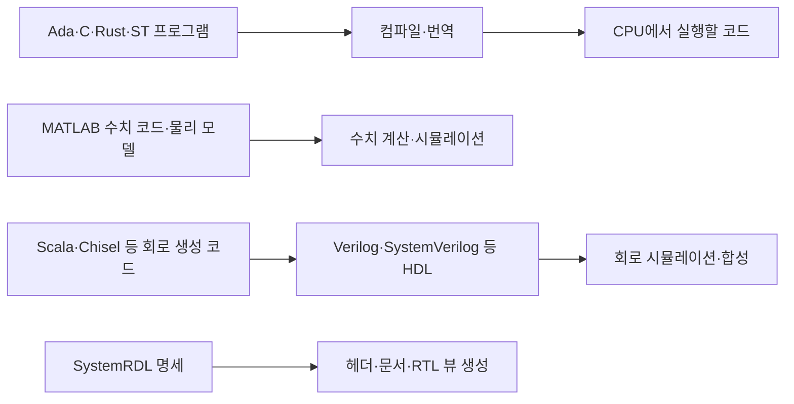

# 하드웨어·제어 현장의 프로그램·모델·명세 언어 | Languages for hardware and control workflows

C·C++·Python만으로 모든 분야의 코드를 설명할 수는 없습니다. 같은 제품 안에서도 CPU 프로그램, 회로, 물리 모델, PLC 프로그램, 레지스터 명세와 설계 도구 스크립트를 서로 다른 언어로 작성합니다. 이 목차는 표준과 실제 개발 제품의 공식 자료를 근거로 역할을 구분하며, 보급률이나 채용 순위를 추정하지 않습니다.

[하드웨어 코딩](../README.md) · [언어별 실무 역할과 출처](언어별역할과출처_language-roles.md) · [실행 기록](확인기록_validation.md)

## 작성 언어와 실행 대상을 구분합니다

RTL(Register Transfer Level)은 레지스터와 그 사이의 연산·데이터 이동을 표현하는 설계 수준입니다. 언어 이름이 아닙니다. Verilog·SystemVerilog뿐 아니라 VHDL로도 RTL을 작성합니다. [AMD Vivado UG901의 합성 안내](https://www.amd.com/content/dam/xilinx/support/documents/sw_manuals/xilinx2022_1/ug901-vivado-synthesis.pdf)는 이 언어들의 합성 가능한 부분집합을 구분합니다. 이 2022.1 문서를 현재 도구의 모든 지원 구문 목록으로 사용하지는 않습니다.

CPU 프로그램의 순차 실행과 HDL의 동시 회로 모델은 다릅니다. HDL 시뮬레이터가 회로 모델을 계산하는 것, 합성 도구가 그 모델을 회로 구조로 변환하는 것, 배치·배선 후 실제 칩에서 동작하는 것은 각각 별도의 확인 대상입니다. SystemVerilog의 테스트벤치 클래스·검증 코드도 모두 합성되는 것은 아닙니다.



이 그림은 가능한 흐름의 예시입니다. 모든 모델·명세가 자동으로 C나 RTL로 변환되는 것은 아니며 지원 도구와 입력 조건이 필요합니다. ST가 C로 번역되거나 Simulink 모델에서 C를 생성해도 처음 작성한 언어와 모델의 의미가 C 문법으로 바뀌는 것은 아닙니다. Python으로 작성한 검사기가 Ada·ST·SystemRDL 도구를 실행하는 경우에도 검사기의 언어와 검사 대상의 언어를 구분합니다.

## 실제 실행 예제

| 공부할 대상 | 작성 언어·형식 | 예제에서 따라갈 흐름 | 기록한 실행 범위 |
| --- | --- | --- | --- |
| [레지스터 주소·필드의 공통 원천](01-레지스터명세_systemrdl/README.md) | SystemRDL입니다. | 명세 → 실제 컴파일·elaboration → 속성 비교 → C 헤더 생성·컴파일입니다. | 명세와 헤더의 주소·마스크·형식 대조입니다. |
| [행렬과 동적 계통의 수치 계산](02-수치계산_matlab-octave/README.md) | MATLAB 계열 `.m` 코드입니다. | 입력·상태 방정식 → 수치 계산 → 독립 해석값·오차 비교입니다. | GNU Octave의 실제 `.m` 실행이며 MATLAB·Simulink 실행과 구분합니다. |
| [정수 범위와 호출 계약](03-계약과범위_ada-spark/README.md) | Ada·SPARK 계약 표기입니다. | 자료형·사전조건 → 실제 GNAT 컴파일 → 정상값·잘못된 호출입니다. | 호스트 실행과 런타임 계약 검사이며 GNATprove 증명과 구분합니다. |
| [PLC의 스캔과 상태 유지](04-PLC스캔_structured-text/README.md) | IEC 61131-3 Structured Text입니다. | 함수 블록 → 실제 ST 번역 → 생성 코드 실행 → 매 호출의 상태입니다. | 호스트에서 번역한 블록을 호출하며 실제 PLC·I/O 구동과 구분합니다. |

각 예제에는 전체 소스와 짧은 줄별 주석, 입력부터 결과까지의 흐름, 풀이 요약, 실제 명령과 결과 파일을 연결합니다. 주석은 복습할 때 해당 줄의 문법과 목적을 바로 읽을 수 있도록 적습니다. 기존 프로그래머스 풀이와 별도로 작성한 예제입니다.

## 이미 실행한 다른 언어와 도구

- [VHDL 카운터](../예제_examples/04-카운터와범위_vhdl-counter/README.md)는 Verilog 이외의 HDL로 같은 클록·리셋·범위 문제를 읽는 예제입니다.
- [Rust](../언어확장_language-expansion/04-Rust프레임과비트필드_rust-firmware/README.md)는 소유권·빌림·범위 검사와 `no_std` 라이브러리를 다룹니다.
- [RISC-V 어셈블리](../언어확장_language-expansion/01-RISC-V비트처리_riscv-assembly/README.md)는 CPU 명령·메모리·호출 규약을 다룹니다.
- [SPICE](../언어확장_language-expansion/03-아날로그회로_spice/README.md)는 아날로그 소자와 시간·주파수 응답을 다룹니다.
- [Tcl·SDC](../언어확장_language-expansion/05-설계자동화_tcl-sdc/README.md)는 설계 도구의 실행과 타이밍 요구 조건의 표현을 다룹니다.
- [SystemC](../언어확장_language-expansion/06-Cpp이벤트모델_systemc/README.md)는 C++ 라이브러리 기반 시간 모형이며 독립된 범용 프로그래밍 언어로 세지 않습니다.
- [URDF](../응용시스템_applied-systems/05-로봇구조와관절_urdf/README.md)와 [Protocol Buffers](../응용시스템_applied-systems/06-벤치텔레메트리_protobuf/README.md)는 로봇 구조와 메시지의 명세 형식입니다.

Modelica·FPP·Chisel·Verilog-AMS와 PLC의 그래픽 언어는 [언어별 역할](언어별역할과출처_language-roles.md)에서 공식 학습 경로와 현재 실행 여부를 함께 안내합니다. 도구의 존재만 확인한 자료를 직접 실행한 예제와 합치지 않습니다.

## 파일과 기록 대조

[catalog.json](catalog.json)은 예제·소스·실행 기록을 연결하는 기계 판독용 목록입니다. [check_sources.py](check_sources.py)는 게시 소스의 해시와 README의 전체 코드, 카탈로그·완료 출력·로컬 파일 링크를 확인합니다. 이 정적 대조는 언어 도구나 실습을 다시 실행하지 않습니다. 실제 재현은 각 README의 명령과 의존성 판본을 사용합니다.

```bash
python -B 하드웨어코딩_hardware-coding/현업언어_industry-languages/check_sources.py --report /path/to/current-source-check.json
```

## English

Programming languages, hardware description languages, numerical and graphical models, register specifications, and tool scripts serve different roles. The examples record actual SystemRDL compilation and header generation, GNU Octave execution, Ada compilation and runtime contracts, and ST-to-C translation with host checks. RTL is an abstraction level, and VHDL is an RTL language alongside Verilog and SystemVerilog. Reading external tooling is kept separate from execution, proof, synthesis and physical validation.
